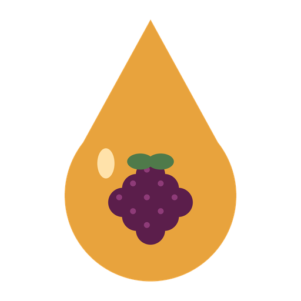
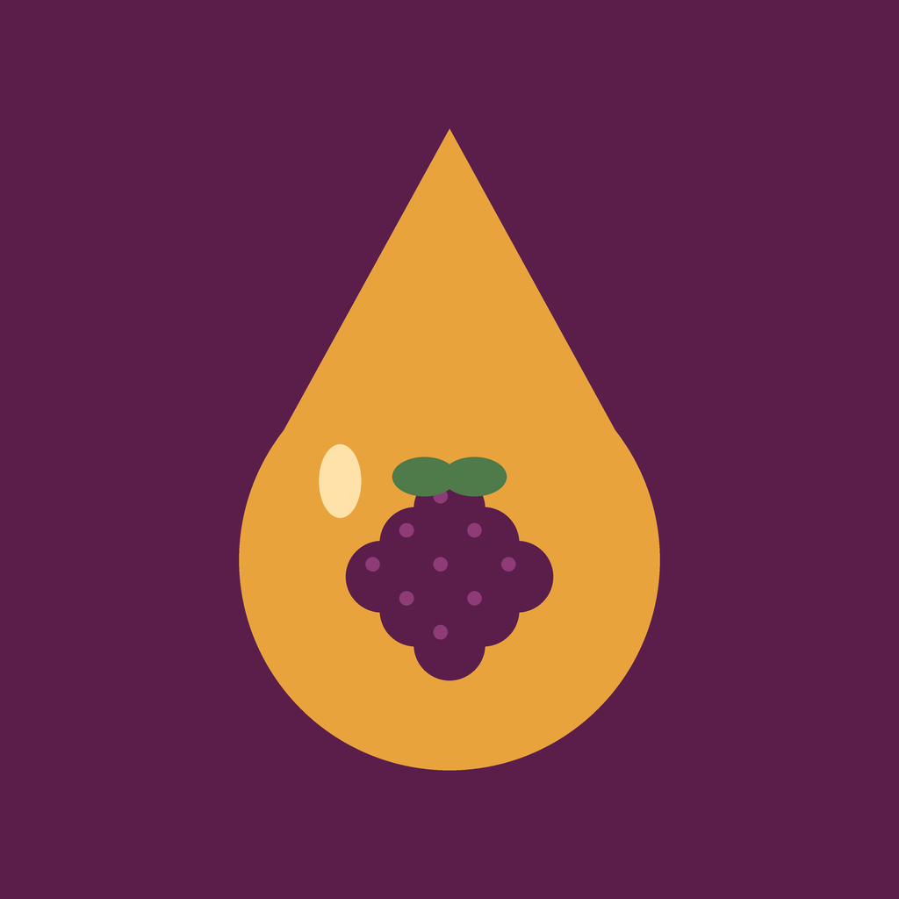
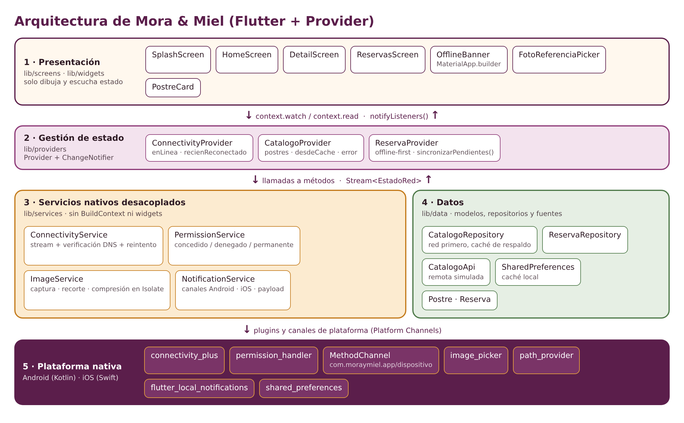

<p align="center">
  
</p>

<h1 align="center">Mora &amp; Miel · Pastelería artesanal</h1>

<p align="center">
  Aplicación Flutter de catálogo y reservas de postres con soporte offline,<br>
  cámara con permisos en tiempo de ejecución y notificaciones locales.<br>
  <b>Actividad Integradora 2</b> · Desarrollo de Aplicaciones Móviles
</p>

> **Origen del proyecto:** esta app es la **reingeniería del proyecto de la Actividad Integradora 1**
> (*Dulce Antojo*, catálogo de postres con 2 pantallas). Se conservó el historial y se evolucionó
> mediante un rebranding completo y la integración de servicios nativos.

---

## 1. Rebranding

| Elemento | Antes (Actividad 1) | Después (Actividad 2) |
|---|---|---|
| Nombre comercial | Dulce Antojo | **Mora & Miel** |
| Package Android | `com.dulceantojo.dulce_antojo` | **`com.moraymiel.app`** |
| Bundle ID iOS | `com.dulceantojo.dulceAntojo` | **`com.moraymiel.app`** |
| Paquete Dart | `dulce_antojo` | `mora_y_miel` (v2.0.0+2) |
| Ícono | Ícono por defecto de Flutter | Gota de miel con mora (legacy + adaptativo) |
| Splash | Fondo blanco vacío | Fondo mora + logo (Android < 12, Android 12+ y iOS) + splash animado en Flutter |
| Paleta | `Colors.pink` repetido en cada widget | Tema central `AppTheme` / `AppColors` |

| Antes | Después |
|:---:|:---:|
|  |  |

**Paleta:** Mora `#5B1E4B` · Mora claro `#8E3B78` · Miel `#E8A33D` · Crema `#FFF8EE` · Cacao `#2E1A24` · Hoja `#4F7A4A` · Alerta `#B3261E`

## 2. Servicios nativos

| Servicio | Archivo | Qué hace |
|---|---|---|
| Conectividad reactiva | `lib/services/connectivity_service.dart` | Escucha `onConnectivityChanged` (stream nativo), verifica internet real con DNS, reintenta y publica un `Stream<EstadoRed>`. |
| Banner offline | `lib/widgets/offline_banner.dart` | Banner flotante global (rojo sin red / verde al reconectar) colocado en `MaterialApp.builder`. |
| Caché / persistencia | `lib/data/repositories/*` | Catálogo “red primero, caché de respaldo” y reservas guardadas en `SharedPreferences`. Reservas offline quedan *pendientes* y se sincronizan solas al reconectar. |
| Permisos en tiempo de ejecución | `lib/services/permission_service.dart` | Cámara y galería con `permission_handler`; maneja *denegado*, *denegado permanente* (diálogo → Ajustes) y *restringido*. Usa un **MethodChannel propio** (`MainActivity.kt`) para saber el API level de Android. |
| Cámara / galería / recorte / compresión | `lib/services/image_service.dart` | `image_picker` + recorte cuadrado 1:1 + compresión JPG (calidad 75) en un **Isolate** (`compute`). Recupera fotos si Android destruyó la Activity (`retrieveLostData`). |
| Notificaciones locales | `lib/services/notification_service.dart` | `flutter_local_notifications` con canales Android **reservas** (alta) y **sincronizacion**; iOS con `DarwinNotificationDetails`. Al tocarla abre *Mis reservas*. |

Eventos que disparan notificaciones: **reserva confirmada**, **reserva guardada sin conexión** y **reservas sincronizadas** al volver internet.

## 3. Arquitectura



- **Presentación** (`screens/`, `widgets/`): solo dibuja y escucha estado.
- **Estado** (`providers/`): `ChangeNotifier` + `provider` (inyección con `MultiProvider` en `main.dart`).
- **Servicios nativos** (`services/`): clases Dart puras, sin `BuildContext`; se pueden probar y reemplazar.
- **Datos** (`data/`): modelos, repositorios y fuentes (API simulada + caché local).

```
lib/
├── main.dart                     # MultiProvider + rutas + banner global
├── core/
│   ├── navegacion.dart           # navigatorKey global (abrir pantalla desde notificación)
│   └── theme/ app_colors.dart · app_theme.dart
├── data/
│   ├── models/ postre.dart · reserva.dart
│   ├── sources/ catalogo_api.dart
│   └── repositories/ catalogo_repository.dart · reserva_repository.dart
├── providers/ connectivity_provider.dart · catalogo_provider.dart · reserva_provider.dart
├── services/ connectivity_service.dart · permission_service.dart · image_service.dart · notification_service.dart
├── screens/ splash_screen.dart · home_screen.dart · detail_screen.dart · reservas_screen.dart
└── widgets/ postre_card.dart · offline_banner.dart · foto_referencia_picker.dart
```

## 4. Instalación y ejecución

**Requisitos:** Flutter 3.41 o superior (Dart ≥ 3.12), Android Studio con un emulador (API 24+) o un dispositivo físico. Para iOS: Xcode 16+.

```bash
git clone https://github.com/<tu-usuario>/mora-y-miel-flutter.git
cd mora-y-miel-flutter
flutter pub get
flutter run
```

> Si vienes de una versión anterior del proyecto ejecuta `flutter clean` antes de `flutter run`
> (cambió el package id y la carpeta de `MainActivity.kt`).

### Configuración extra para iOS (CocoaPods)
`permission_handler` necesita activar los permisos usados en `ios/Podfile` (se genera tras el primer `flutter run`/`pod install`):

```ruby
post_install do |installer|
  installer.pods_project.targets.each do |target|
    flutter_additional_ios_build_settings(target)
    target.build_configurations.each do |config|
      config.build_settings['GCC_PREPROCESSOR_DEFINITIONS'] ||= [
        '$(inherited)',
        'PERMISSION_CAMERA=1',
        'PERMISSION_PHOTOS=1',
      ]
    end
  end
end
```

## 5. Cómo probar cada servicio (QA)

| Prueba | Pasos | Resultado esperado |
|---|---|---|
| Modo offline | Abrir la app → activar modo avión | Banner rojo “Sin conexión”; el catálogo se muestra desde la caché (“Mostrando catálogo guardado”). |
| Reconexión | Desactivar modo avión | Banner verde “Conexión restablecida”; el catálogo se refresca solo. |
| Reserva offline | En modo avión reservar un postre | Notificación “Reserva guardada sin conexión”; en *Mis reservas* aparece **Pendiente**. Al reconectar: notificación “Reservas sincronizadas” y estado **Confirmada**. |
| Permiso de cámara | Detalle → *Cámara* | Diálogo del sistema. Si se niega: aviso. Si se niega 2 veces / “No volver a preguntar”: diálogo con **Abrir Ajustes**. |
| Recorte y compresión | Tomar o elegir una foto | Vista previa 1:1 con tamaño original → comprimido y % de ahorro. |
| Notificaciones | Primera apertura (Android 13+/iOS) → aceptar permiso → reservar | Notificación “¡Reserva confirmada!”; al tocarla abre *Mis reservas*. |

Comandos útiles: `flutter analyze` (el proyecto no tiene advertencias) y, en el emulador Android, *Extended controls → Cellular/Wi-Fi* o `adb shell svc wifi disable` para simular la pérdida de red.

## 6. Control de versiones

| Rama | Propósito |
|---|---|
| `main` | Versión estable. Etiquetas `v2.0.0-branding` (rebranding) y `v2.0.0` (release final). |
| `develop` | Integración de funcionalidades. |
| `feature/rebranding` | Nombre, package id, paleta, ícono y splash. |
| `feature/arquitectura-provider` | Capas data/providers y caché local. |
| `feature/conectividad` | Servicio de red, banner offline y sincronización. |
| `feature/camara-permisos` | Permisos en tiempo de ejecución, cámara/galería, recorte y compresión. |
| `feature/notificaciones` | Canales Android/iOS y notificaciones locales. |

Flujo: `feature/*` → `develop` (merge `--no-ff`) → `main` (release). Mensajes de commit con *Conventional Commits* (`feat`, `refactor`, `style`, `docs`, `chore`).

## 7. Documentación

El informe técnico de la actividad está en [`docs/`](docs/).

## Créditos

- **Autora:** Cinthia Marisol Guamán Montaño
- Fotos de los postres: Wikimedia Commons.
- Se utilizó un asistente de IA (Claude, de Anthropic) como apoyo; ver la declaración en el informe.
